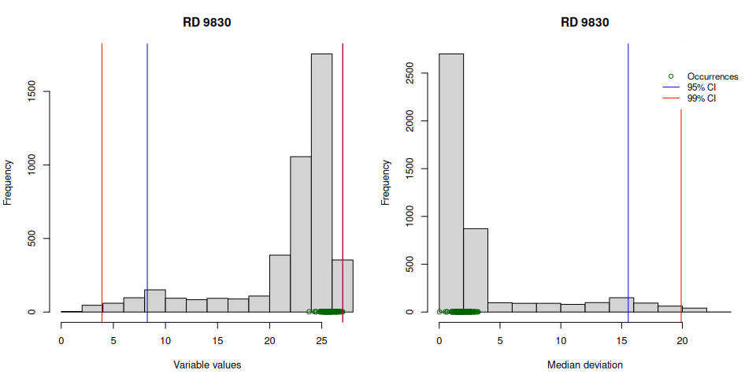
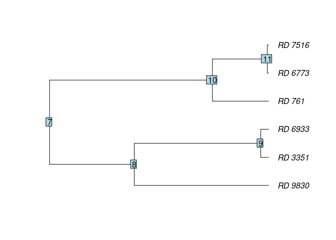
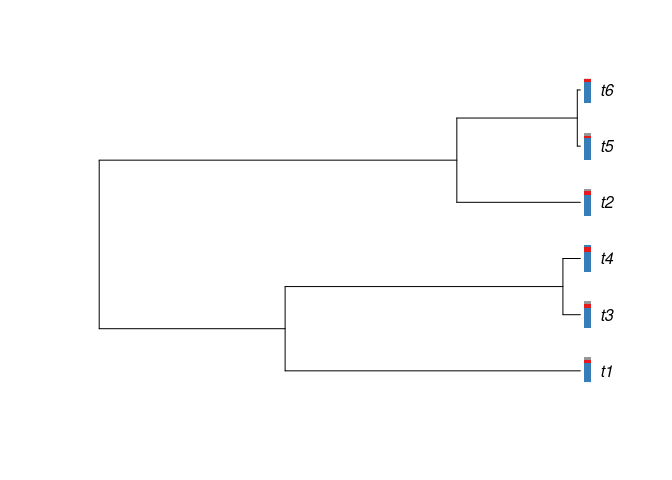
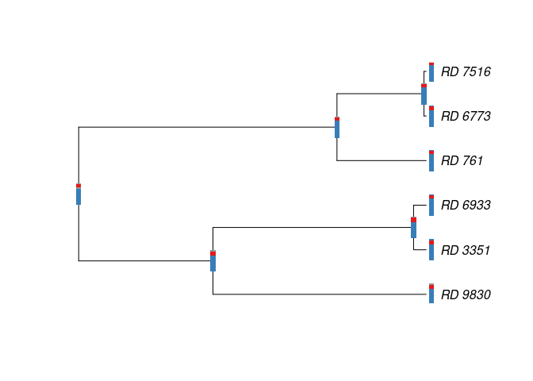
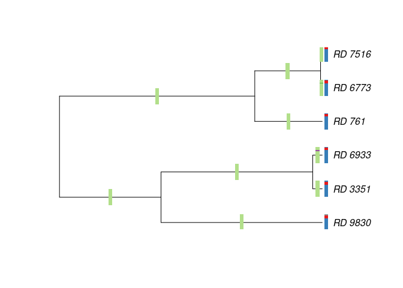
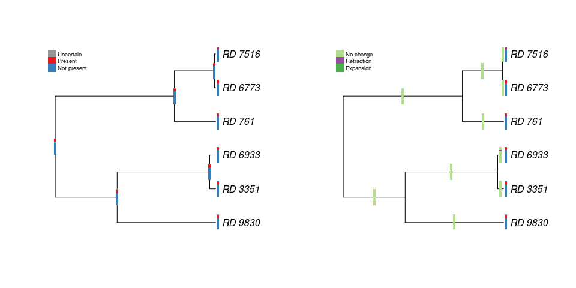
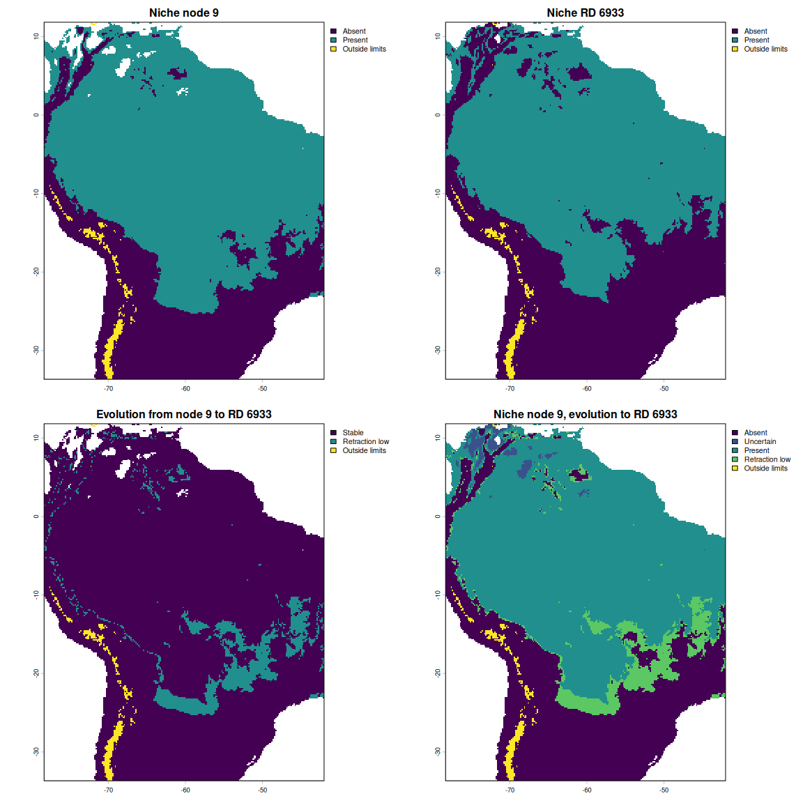

nichevol: Tools for Ecological Niche Evolution Assessment Considering
Uncertainty
================
Marlon E. Cobos, Hannah L. Owens, and A. Townsend Peterson

- [Package description](#package-description)
- [How to cite](#how-to-cite)
- [Installing the package](#installing-the-package)
  - [Stable version](#stable-version)
  - [Latest version](#latest-version)
- [Exploring the nichevol package](#exploring-the-nichevol-package)
  - [Setting a directory](#setting-a-directory)
  - [Loading the package](#loading-the-package)
  - [Functions in nichevol](#functions-in-nichevol)
- [Using nichevol with simple
  examples](#using-nichevol-with-simple-examples)
  - [Packages needed for data
    management](#packages-needed-for-data-management)
  - [Initial data (example data)](#initial-data-example-data)
  - [Preparing data for analyses](#preparing-data-for-analyses)
  - [Ancestral reconstructions and smoothing of
    results](#ancestral-reconstructions-and-smoothing-of-results)
  - [Plotting results on a phylogenetic
    tree](#plotting-results-on-a-phylogenetic-tree)
  - [Mapping niches and evolution](#mapping-niches-and-evolution)
- [References](#references)

<br>

<!-- badges: start -->

[](https://CRAN.R-project.org/package=nichevol)
[](https://cranlogs.r-pkg.org:443/badges/grand-total/nichevol)
[-lightgrey.svg?style=flat)](http://www.gnu.org/licenses/gpl-3.0.html)
[](https://github.com/marlonecobos/nichevol/actions/workflows/check-standard.yaml)

<!-- badges: end -->

<hr>

## Package description

The **nichevol** R package helps users to perform critical steps in the
process of assessment of species’ ecological niche evolution, with
uncertainty incorporated explicitly in reconstructions. The method
proposed here for ancestral reconstruction of ecological niches
characterizes niches using a bin-based approach that incorporates
uncertainty in estimations. Compared to other existing methods, the
approaches presented here reduce risks of overestimation of amounts or
rates of ecological niche evolution. The main analyses include: initial
exploration of environmental data in occurrence records and accessible
areas, preparation of data for phylogenetic analyses, comparative
phylogenetic analyses, and plotting for interpretation.

<br>

## How to cite

To cite the methods implemented in this package use:

Owens HL, Ribeiro V, Saupe EE, Cobos ME, Hosner PA, Cooper JC, Samy AM,
Barve V, Barve N, Muñoz-R. CJ, Peterson AT (2020) Acknowledging
uncertainty in evolutionary reconstructions of ecological niches.
Ecology and Evolution 10: 6967–6977. <https://doi.org/10.1002/ece3.6359>

Cobos ME, Cheng Y, Song G, Lei F, Peterson AT. (2021) New distributional
opportunities with niche innovation in Eurasian Snowfinches. Journal of
Avian Biology 52(12): e02868. <https://doi.org/10.1111/jav.02868>.

<br>

<hr>

## Installing the package

### Stable version

The stable version of **nichevol** is on **CRAN**, and can be installed
using the code below:

``` r
install.packages("nichevol")
```

### Latest version

The most recent version of **nichevol** is available from this GitHub
repository and can be installed using the code below. Please, have in
mind that updates will be done on this version continuously.

Note: Try the code below first… If you have any problem during the
installation, restart your R session, close other sessions you may have
open, and try again. If during the installation you are asked to update
packages, please do it. If any of the packages gives an error, please
install it alone using *install.packages()*, then try re-installing
**nichevol** again. Also, it may be a good idea to update R and RStudio
(if you are using this last).

``` r
# Installing and loading packages
if(!require(remotes)){
    install.packages("remotes")
}

remotes::install_github("marlonecobos/nichevol")
```

<br>

<hr>

## Exploring the nichevol package

### Setting a directory

Some of the main functions of **nichevol** use data that need to be
loaded from a local directory and others produce results that need to be
written to a local directory. Loading data from a local directory and
writing the results outside the R environment helps to avoid problems
related to RAM limitations. That is why setting a working directory is
recommended before starting, as follows:

``` r
directory <- "DRIVE:/YOUR/DIRECTORY" # change the characters accordingly
setwd(directory) 
```

<br>

### Loading the package

Once **nichevol** is installed, you can load the package with the
following line.

``` r
library(nichevol)
```

<br>

### Functions in nichevol

Three main types of functions are included in **nichevol**: (1) ones
that help in preparing data (exploration plots and tables of characters)
for ancestral reconstruction; (2) ones that perform the ancestral
reconstructions (maximum parsimony and maximum likelihood); and (3) some
complementary functions that help in performing post-reconstruction
steps (reconstruction smoothing, and niche and niche evolution
representations). Of course, other helper functions are used in the
package, but they won’t be used as commonly.

A complete list of the functions in the **nichevol** package can be
found in the package documentation. Use the following code to see the
list.

``` r
help(nichevol)
```

<br>

#### Functions for data preparation

These functions are used to explore numerically and graphically the
environments of the areas accessible to the species (**M**) and their
occurrences. They also help users to prepare tables of characters that
represent species’ ecological niches considering used and non-used
conditions, as well as conditions where the use is uncertain. Most of
the functions in this module can consider all species of interest and
multiple environmental variables at the time. For that reason, they read
data from a local directory and have the option to write results to such
directories as well. The functions that work with data from the R
environment are the ones specifically designed to work with multiple
species but only one variable. These last functions do not write results
to local directories. We have intentionally designed some of our
functions to work interacting with local directories to avoid
RAM-related limitations (especially when working with multiple
environmental raster layers at high resolution).

#### Functions for ancestral reconstruction

This module contains functions that help in performing ancestral
reconstruction of species’ ecological niches. These functions use as
inputs the results of the ones from the previous module (tables of
characters) and phylogenetic trees, as in objects of class “phylo” (see
the package **ape**). There are two types of reconstructions available
to date (maximum parsimony and maximum likelihood), but at least one
other type will be included. All these functions use inputs and produce
outputs in the R environment.

#### Functions for post-reconstruction processes

Functions in this module are intended to help with two main processes.
First, one of these functions helps in smoothing results from ancestral
reconstructions. This is necessary to prevent misinterpretations of
results from comparing reconstructed niches of ancestors with niches of
descendants. Other functions help in representing results of previous
analyses. For instance, they help in producing bar-like labels that
represent the niches of species, or they can be used to represent how
niches have evolved across the phylogeny. Another function helps in
mapping niches and niche evolution in geographic space.

<br>

<hr>

## Using nichevol with simple examples

### Packages needed for data management

The following packages are needed for specific tasks. They are used
internally by **nichevol**, and parts of the code for the examples below
will require them. Notice that **nichevol** is already loaded, but these
other packages need to be loaded separately.

``` r
library(terra) # for reading environmental layers and spatial objects
library(ape) # for plotting phylogenetic trees and node labels
library(geiger) # for merging a phylogenetic tree with a table of niche characters
```

### Initial data (example data)

The following lines of code will help to get example data prepared for
demonstrating the usage of **nichevol**. These data are similar to the
ones used in an article in which the methods implemented in **nichevol**
were proposed, illustrated, and explained (see Owens et al. 2020). These
data are included in the package, so their use is straightforward.

``` r
## list of species records
data("occ_list", package = "nichevol")

## list of species accessible areas
m_files <- list.files(system.file("extdata", package = "nichevol"),
                      pattern = "m\\d.gpkg", full.names = TRUE)

m_list <- lapply(m_files, terra::vect)

## raster variable
temp <- rast(system.file("extdata", "temp.tif", package = "nichevol"))

# a simple phylogenetic tree for demonstrations
data("tree", package = "nichevol")
```

<br>

### Preparing data for analyses

Before starting to play with the functions, consider that **nichevol**
allows distinct ways to prepare data, depending on the user’s needs. The
example data downloaded before can be used with the functions designed
to work with multiple variables and all taxa at a time
(`histograms_env`, `stats_evalues`, `bin_tables`, `bin_tables0`).
However, examples with the functions that work with data in the R
environment and only for one variable at a time are shown in detail
here.

#### Exploring data numerically

First check the function documentation:

``` r
help(stats_eval)
```

Now, to run the code,

``` r
stat <- stats_eval(stats = c("mean", "sd", "median", "range", "quantile"), 
                   Ms = m_list, occurrences = occ_list, species = "species",
                   longitude = "x", latitude = "y", variable = temp, 
                   percentage_out = 0)

knitr::kable(stat[[1]], caption = "Table of descriptive statistics of temperature (x 10) in accessible areas for the species of interest.", digits = 2) # %>% kable_styling(font_size = 12)
```

| Species | mean | sd | median | range1 | range2 | quantile.0. | quantile.25. | quantile.50. | quantile.75. | quantile.100. |
|:---|---:|---:|---:|---:|---:|---:|---:|---:|---:|---:|
| RD 9830 | 21.84 | 5.54 | 23.81 | 1.56 | 27.01 | 1.56 | 21.69 | 23.81 | 25.35 | 27.01 |
| RD 3351 | 24.36 | 1.65 | 24.84 | 17.56 | 27.01 | 17.56 | 23.45 | 24.84 | 25.54 | 27.01 |
| RD 6933 | 15.67 | 7.47 | 17.53 | -0.01 | 27.16 | -0.01 | 8.49 | 17.53 | 21.51 | 27.16 |
| RD 761 | 22.28 | 5.35 | 23.71 | -3.20 | 27.01 | -3.20 | 22.52 | 23.71 | 25.21 | 27.01 |
| RD 6773 | 25.00 | 1.05 | 25.14 | 16.67 | 27.01 | 16.67 | 24.41 | 25.14 | 25.74 | 27.01 |
| RD 7516 | 20.95 | 7.68 | 25.12 | -3.72 | 28.91 | -3.72 | 16.40 | 25.12 | 26.07 | 28.91 |

Table of descriptive statistics of temperature (x 10) in accessible
areas for the species of interest.

``` r

knitr::kable(stat[[2]], caption = "Table of descriptive statistics of temperature (x 10) in occurrences of the species of interest.", digits = 2) #%>% kable_styling(font_size = 12)
```

| Species | mean | sd | median | range1 | range2 | quantile.0. | quantile.25. | quantile.50. | quantile.75. | quantile.100. |
|:---|---:|---:|---:|---:|---:|---:|---:|---:|---:|---:|
| RD 9830 | 25.67 | 0.54 | 25.59 | 23.79 | 27.01 | 23.79 | 25.36 | 25.59 | 26.02 | 27.01 |
| RD 3351 | 25.49 | 0.67 | 25.54 | 23.67 | 27.00 | 23.67 | 25.08 | 25.54 | 25.90 | 27.00 |
| RD 6933 | 25.95 | 0.73 | 25.91 | 24.47 | 27.11 | 24.47 | 25.35 | 25.91 | 26.72 | 27.11 |
| RD 761 | 25.59 | 0.59 | 25.59 | 24.02 | 26.89 | 24.02 | 25.21 | 25.59 | 26.02 | 26.89 |
| RD 6773 | 25.34 | 0.69 | 25.41 | 23.61 | 26.98 | 23.61 | 24.82 | 25.41 | 25.83 | 26.98 |
| RD 7516 | 25.78 | 0.65 | 25.91 | 24.09 | 27.72 | 24.09 | 25.31 | 25.91 | 26.14 | 27.72 |

Table of descriptive statistics of temperature (x 10) in occurrences of
the species of interest.

To work with multiple variables check the function `stats_evalues`.

<br>

#### Exploring data graphically

First check the help:

``` r
help(hist_evalues)
```

Now, to run the code,

``` r
hist_evalues(M = m_list[[1]], occurrences = occ_list[[1]], species = "species", 
             longitude = "x", latitude = "y", variable = temp,
             CL_lines = c(95, 99), col = c("blue", "red"))
```

<!-- -->

To work with multiple variables check the function `histograms_env`.

<br>

#### Preparing tables of ecological niche characters

First check the help:

``` r
help(bin_table)
```

Now, to run the code,

``` r
bin_tabl <- bin_table(Ms = m_list, occurrences = occ_list, species = "species",
                      longitude = "x", latitude = "y", variable = temp, 
                      percentage_out = 5, n_bins = 20)

knitr::kable(bin_tabl, caption = "Table characters for ecological niches of the species of interest.") #%>% kable_styling(font_size = 12)
```

|  | 3.93 to 5.179 | 5.179 to 6.428 | 6.428 to 7.677 | 7.677 to 8.926 | 8.926 to 10.175 | 10.175 to 11.424 | 11.424 to 12.673 | 12.673 to 13.922 | 13.922 to 15.171 | 15.171 to 16.42 | 16.42 to 17.669 | 17.669 to 18.918 | 18.918 to 20.167 | 20.167 to 21.416 | 21.416 to 22.665 | 22.665 to 23.914 | 23.914 to 25.163 | 25.163 to 26.412 | 26.412 to 27.661 | 27.661 to 28.91 |
|:---|:---|:---|:---|:---|:---|:---|:---|:---|:---|:---|:---|:---|:---|:---|:---|:---|:---|:---|:---|:---|
| RD 9830 | 0 | 0 | 0 | 0 | 0 | 0 | 0 | 0 | 0 | 0 | 0 | 0 | 0 | 0 | 0 | 1 | 1 | 1 | 1 | ? |
| RD 3351 | 0 | 0 | 0 | 0 | 0 | 0 | 0 | 0 | 0 | 0 | 0 | 0 | 0 | 0 | 0 | 1 | 1 | 1 | 1 | 0 |
| RD 6933 | 0 | 0 | 0 | 0 | 0 | 0 | 0 | 0 | 0 | 0 | 0 | 0 | 0 | 0 | 0 | 0 | 1 | 1 | 1 | 0 |
| RD 761 | 0 | 0 | 0 | 0 | 0 | 0 | 0 | 0 | 0 | 0 | 0 | 0 | 0 | 0 | 0 | 0 | 1 | 1 | 1 | 0 |
| RD 6773 | 0 | 0 | 0 | 0 | 0 | 0 | 0 | 0 | 0 | 0 | 0 | 0 | 0 | 0 | 0 | 1 | 1 | 1 | 1 | 0 |
| RD 7516 | 0 | 0 | 0 | 0 | 0 | 0 | 0 | 0 | 0 | 0 | 0 | 0 | 0 | 0 | 0 | 0 | 1 | 1 | 1 | 1 |

Table characters for ecological niches of the species of interest.

To work with multiple variables check the functions `bin_tables0` and
`bin_tables`.

<br>

### Ancestral reconstructions and smoothing of results

These functions work with one variable at the time, but users can
perform several analyses in a loop if needed. The variable to be
explored here is temperature.

#### Phylogenetic tree and data

With the following code, the phylogenetic tree will be plotted, and its
nodes will be added.

``` r
# exploring tree
tree$tip.label <- rownames(bin_tabl)
plot.phylo(tree, label.offset = 0.04)
nodelabels()
```

<!-- -->

<br>

#### Maximum parsimony reconstruction

First check the help:

``` r
help(bin_par_rec)
help(smooth_rec)
```

Now, to run the code,

``` r
# tree and data together
tree_data <- treedata(tree, bin_tabl)

# reconstruction
par_rec_table <- bin_par_rec(tree_data)

# smoothing
s_par_rec_table <- smooth_rec(par_rec_table)

# results
knitr::kable(s_par_rec_table, caption = "Table characters for ecological niches of the species of interest and maximum parsimony reconstructions for their ancestors.") #%>% kable_styling(font_size = 12)
```

|  | 3.93 to 5.179 | 5.179 to 6.428 | 6.428 to 7.677 | 7.677 to 8.926 | 8.926 to 10.175 | 10.175 to 11.424 | 11.424 to 12.673 | 12.673 to 13.922 | 13.922 to 15.171 | 15.171 to 16.42 | 16.42 to 17.669 | 17.669 to 18.918 | 18.918 to 20.167 | 20.167 to 21.416 | 21.416 to 22.665 | 22.665 to 23.914 | 23.914 to 25.163 | 25.163 to 26.412 | 26.412 to 27.661 | 27.661 to 28.91 |
|:---|:---|:---|:---|:---|:---|:---|:---|:---|:---|:---|:---|:---|:---|:---|:---|:---|:---|:---|:---|:---|
| RD 9830 | 0 | 0 | 0 | 0 | 0 | 0 | 0 | 0 | 0 | 0 | 0 | 0 | 0 | 0 | 0 | 1 | 1 | 1 | 1 | ? |
| RD 3351 | 0 | 0 | 0 | 0 | 0 | 0 | 0 | 0 | 0 | 0 | 0 | 0 | 0 | 0 | 0 | 1 | 1 | 1 | 1 | 0 |
| RD 6933 | 0 | 0 | 0 | 0 | 0 | 0 | 0 | 0 | 0 | 0 | 0 | 0 | 0 | 0 | 0 | 0 | 1 | 1 | 1 | 0 |
| RD 761 | 0 | 0 | 0 | 0 | 0 | 0 | 0 | 0 | 0 | 0 | 0 | 0 | 0 | 0 | 0 | 0 | 1 | 1 | 1 | 0 |
| RD 6773 | 0 | 0 | 0 | 0 | 0 | 0 | 0 | 0 | 0 | 0 | 0 | 0 | 0 | 0 | 0 | 1 | 1 | 1 | 1 | 0 |
| RD 7516 | 0 | 0 | 0 | 0 | 0 | 0 | 0 | 0 | 0 | 0 | 0 | 0 | 0 | 0 | 0 | 0 | 1 | 1 | 1 | 1 |
| 7 | 0 | 0 | 0 | 0 | 0 | 0 | 0 | 0 | 0 | 0 | 0 | 0 | 0 | 0 | 0 | ? | 1 | 1 | 1 | ? |
| 8 | 0 | 0 | 0 | 0 | 0 | 0 | 0 | 0 | 0 | 0 | 0 | 0 | 0 | 0 | 0 | 1 | 1 | 1 | 1 | ? |
| 9 | 0 | 0 | 0 | 0 | 0 | 0 | 0 | 0 | 0 | 0 | 0 | 0 | 0 | 0 | 0 | 1 | 1 | 1 | 1 | ? |
| 10 | 0 | 0 | 0 | 0 | 0 | 0 | 0 | 0 | 0 | 0 | 0 | 0 | 0 | 0 | 0 | 0 | 1 | 1 | 1 | ? |
| 11 | 0 | 0 | 0 | 0 | 0 | 0 | 0 | 0 | 0 | 0 | 0 | 0 | 0 | 0 | 0 | 0 | 1 | 1 | 1 | ? |

Table characters for ecological niches of the species of interest and
maximum parsimony reconstructions for their ancestors.

<br>

#### Maximum likelihood reconstruction

First check the help:

``` r
help(bin_ml_rec)
```

Now, to run the code,

``` r
# reconstruction
ml_rec_table <- bin_ml_rec(tree_data)

# smoothing
s_ml_rec_table <- smooth_rec(ml_rec_table)

# results
knitr::kable(s_ml_rec_table, caption = "Table characters for ecological niches of the species of interest and maximum likelihood reconstructions for their ancestors.", digits = 2) #%>% kable_styling(font_size = 12)
```

|  | 3.93 to 5.179 | 5.179 to 6.428 | 6.428 to 7.677 | 7.677 to 8.926 | 8.926 to 10.175 | 10.175 to 11.424 | 11.424 to 12.673 | 12.673 to 13.922 | 13.922 to 15.171 | 15.171 to 16.42 | 16.42 to 17.669 | 17.669 to 18.918 | 18.918 to 20.167 | 20.167 to 21.416 | 21.416 to 22.665 | 22.665 to 23.914 | 23.914 to 25.163 | 25.163 to 26.412 | 26.412 to 27.661 | 27.661 to 28.91 |
|:---|:---|:---|:---|:---|:---|:---|:---|:---|:---|:---|:---|:---|:---|:---|:---|:---|:---|:---|:---|:---|
| RD 9830 | 0 | 0 | 0 | 0 | 0 | 0 | 0 | 0 | 0 | 0 | 0 | 0 | 0 | 0 | 0 | 1 | 1 | 1 | 1 | ? |
| RD 3351 | 0 | 0 | 0 | 0 | 0 | 0 | 0 | 0 | 0 | 0 | 0 | 0 | 0 | 0 | 0 | 1 | 1 | 1 | 1 | 0 |
| RD 6933 | 0 | 0 | 0 | 0 | 0 | 0 | 0 | 0 | 0 | 0 | 0 | 0 | 0 | 0 | 0 | 0 | 1 | 1 | 1 | 0 |
| RD 761 | 0 | 0 | 0 | 0 | 0 | 0 | 0 | 0 | 0 | 0 | 0 | 0 | 0 | 0 | 0 | 0 | 1 | 1 | 1 | 0 |
| RD 6773 | 0 | 0 | 0 | 0 | 0 | 0 | 0 | 0 | 0 | 0 | 0 | 0 | 0 | 0 | 0 | 1 | 1 | 1 | 1 | 0 |
| RD 7516 | 0 | 0 | 0 | 0 | 0 | 0 | 0 | 0 | 0 | 0 | 0 | 0 | 0 | 0 | 0 | 0 | 1 | 1 | 1 | 1 |
| 7 | 0 | 0 | 0 | 0 | 0 | 0 | 0 | 0 | 0 | 0 | 0 | 0 | 0 | 0 | 0 | ? | 1 | 1 | 1 | ? |
| 8 | 0 | 0 | 0 | 0 | 0 | 0 | 0 | 0 | 0 | 0 | 0 | 0 | 0 | 0 | 0 | ? | 1 | 1 | 1 | ? |
| 9 | 0 | 0 | 0 | 0 | 0 | 0 | 0 | 0 | 0 | 0 | 0 | 0 | 0 | 0 | 0 | ? | 1 | 1 | 1 | ? |
| 10 | 0 | 0 | 0 | 0 | 0 | 0 | 0 | 0 | 0 | 0 | 0 | 0 | 0 | 0 | 0 | ? | 1 | 1 | 1 | ? |
| 11 | 0 | 0 | 0 | 0 | 0 | 0 | 0 | 0 | 0 | 0 | 0 | 0 | 0 | 0 | 0 | ? | 1 | 1 | 1 | ? |
| LogLik | NA | NA | NA | NA | NA | NA | NA | NA | NA | NA | NA | NA | NA | NA | NA | -3.46573590313476 | NA | NA | NA | -5.49306144389102 |
| Rates | NA | NA | NA | NA | NA | NA | NA | NA | NA | NA | NA | NA | NA | NA | NA | 855.827324232269 | NA | NA | NA | 557.581538883981 |
| SE | NA | NA | NA | NA | NA | NA | NA | NA | NA | NA | NA | NA | NA | NA | NA | 1435839.98773384 | NA | NA | NA | 37388.7646050392 |

Table characters for ecological niches of the species of interest and
maximum likelihood reconstructions for their ancestors.

<br>

### Plotting results on a phylogenetic tree

#### Ecological niches of species on the phylogeny

``` r
plot.phylo(tree, label.offset = 0.04)
niche_labels(tree, s_par_rec_table, label_type = "tip", height = 0.8, width = 1.5)
```

<!-- -->

#### Reconstructed ecological niches of ancestors

``` r
plot.phylo(tree, label.offset = 0.04)
niche_labels(tree, s_par_rec_table, label_type = "tip_node", height = 0.8, width = 1.5)
```

<!-- -->

#### Evolution of ecological niches in the group

The function nichevol_labels() is used to represent the evolution of
ecological niches in the phylogeny. The function uses the results of the
ancestral reconstruction and smoothing of results. The colors represent
the changes from ancestral to descendant niches. Uncertainty in the
reconstructions is the result of comparisons when the state of the niche
is unknown in the ancestor or descendant.

``` r
plot.phylo(tree, label.offset = 0.04)
niche_labels(tree, s_par_rec_table, label_type = "tip", height = 0.8, width = 1.5)
nichevol_labels(tree, s_par_rec_table, height = 0.8, width = 1.5)
```

<!-- -->

#### A more informative plot

The functions niche_legend() and nichevol_legend() are used to add
legends to the plot.

``` r
par(mfrow = c(1, 2))
plot.phylo(tree, label.offset = 0.04)
niche_labels(tree, s_par_rec_table, label_type = "tip_node", height = 0.8, width = 1.5)
niche_legend(position = "topleft", cex = 0.6)

plot.phylo(tree, label.offset = 0.04)
niche_labels(tree, s_par_rec_table, label_type = "tip", height = 0.8, width = 1.5)
nichevol_labels(tree, s_par_rec_table, height = 0.8, width = 1.5)
nichevol_legend(position = "topleft", cex = 0.6)
```

<!-- -->

<br>

### Mapping niches and evolution

Niche evolution occurred between node 9 and the species RD 6933. Let’s
map and see how things look like in geography. The label outside limits
in the legend refers to areas with environments that were not considered
in the analyses (i.e., environments outside the range of values in the
bins). See documentation of the function `map_nichevol` for more
details.

``` r
# preparing layers to represent niches and evolution
niche9 <- map_nichevol(whole_rec_table = s_par_rec_table, variable = temp, 
                       return = "niche", from = "9")
nichesp <- map_nichevol(whole_rec_table = s_par_rec_table, variable = temp, 
                        return = "niche", from = "RD 6933")

evol_8vssp <- map_nichevol(whole_rec_table = s_par_rec_table, variable = temp, 
                           return = "evolution", from = "9", to = "RD 6933")
nichevol_8vssp <- map_nichevol(whole_rec_table = s_par_rec_table, variable = temp, 
                               return = "nichevol", from = "9", to = "RD 6933")

par(mfrow = c(2, 2))
plot(niche9, main = "Niche node 9")
plot(nichesp, main = "Niche RD 6933")

plot(evol_8vssp, main = "Evolution from node 9 to RD 6933")
plot(nichevol_8vssp, main = "Niche node 9, evolution to RD 6933")
```

<!-- -->

<br>

<hr>

## References

- Barve, N., V. Barve, A. Jimenez-Valverde, A. Lira-Noriega, S. P.
  Maher, A. T. Peterson, J. Soberón, and F. Villalobos. 2011. The
  crucial role of the accessible area in ecological niche modeling and
  species distribution modeling. Ecological Modelling 222:1810-1819.
- Machado-Stredel, F., M. E. Cobos, and A. T. Peterson. 2021. A
  simulation-based method for selecting calibration areas for ecological
  niche models and species distribution models. Frontiers of
  Biogeography, 13(4):e48814e.
- Owens, H. L., L. P. Campbell, L. L. Dornak, E. E. Saupe, N. Barve, J.
  Soberón, K. Ingenloff, A. Lira-Noriega, C. M. Hensz, C. E. Myers,
  and A. T. Peterson. 2013. Constraints on interpretation of ecological
  niche models by limited environmental ranges on calibration areas.
  Ecological Modelling 263:10-18.
- Owens, H. L., V. Ribeiro, E. E. Saupe, M. E. Cobos, P. A.
  Hosner, J. C. Cooper, A. M. Samy, V. Barve, N. Barve, C. J.
  Muñoz-R, A. T. Peterson. 2020. Acknowledging Uncertainty in
  Evolutionary Reconstructions of Ecological Niches. Ecology and
  Evolution 10(14):6967–6977.
